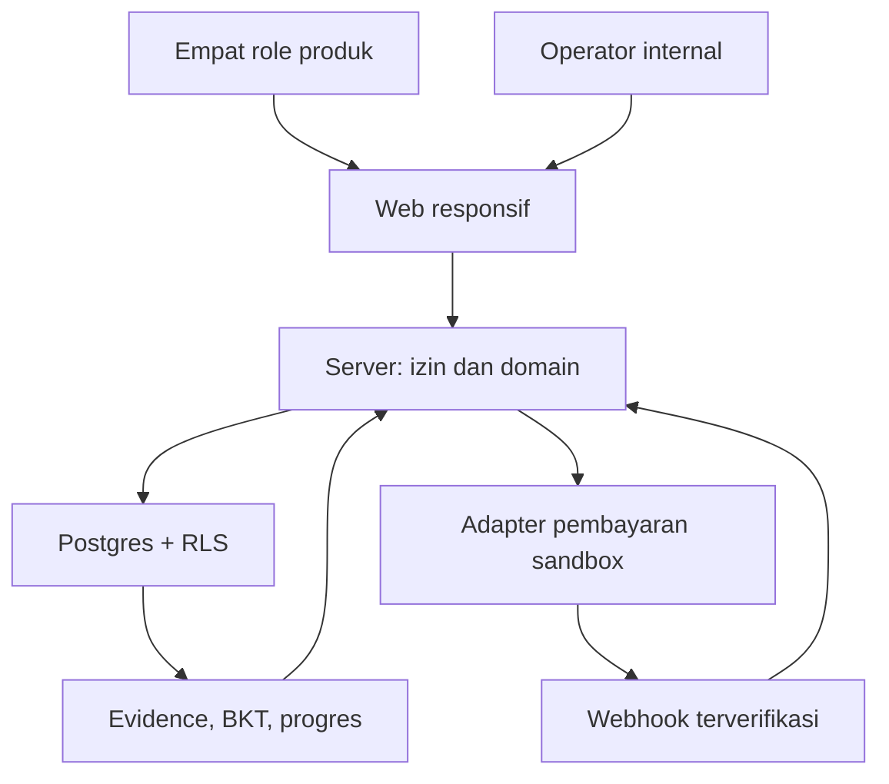

# Arsitektur usulan NUMERIQ
Status proposal, OD-08; belum ada dependensi terpasang atau kompatibilitas versi terverifikasi.
Satu aplikasi modular Next.js App Router + TypeScript; Tailwind dan komponen accessible, Zod; Supabase lokal Postgres/Auth dengan RLS; Vitest/Testing Library dan Playwright. Tanpa ORM tambahan. Pilihan mengikuti preferensi master prompt, bukan keputusan versi final.

## Konteks sistem

## Struktur rencana
src/app: public, school, teacher, student, parent, internal route groups.
src/components: ui, shells, activities.
src/modules: identity-access, institutions, guardian-consent, subscriptions-entitlements, learning-content, assessments, misconception-rules, knowledge-tracing, remediation, progress, audit, internal-ops.
supabase/migrations dan seed.sql; tests/unit, integration, e2e; docs.
Semua path di atas adalah rencana, belum dibuat.

## Matriks izin
| Aktor | Baca | Mutasi | Batas |
|---|---|---|---|
| Admin sekolah | Agregat, people, seats, invoice tenant | Invite, assign, request upgrade | Tidak membaca respons individu secara default |
| Guru/GPK | Siswa yang ditugaskan di tenant aktif | Assignment, review, remediasi | Membership dan assignment sama-sama aktif |
| Siswa | Tugas dan progres sendiri | Jawaban sesi sendiri | Consent + entitlement berlaku |
| Wali | Anak dengan verified link | Consent, subscription milik wali | Link aktif; tidak mengubah scoring |
| Operator | Kontrak/payment/support terbatas | Verifikasi dan rekonsiliasi | Privileged permission terpisah, audit wajib |

## Draft tabel dan constraint
| Kelompok | Tabel / kolom penting | Constraint |
|---|---|---|
| Identity | users(auth_uid,status), institutions, memberships(user,institution,role,status) | Unik membership; FK auth; role tidak dikendalikan client |
| Learner | students(id,display_code), student_enrollments(student,institution,status), teacher_students | Composite FK enrollment memastikan pasangan tenant benar |
| Guardian | guardian_students(guardian,student,verification_status), invitations(token_hash,expires_at,used_at) | Token single-use, verified relation |
| Consent | consents(student,guardian,purpose,document_version,status,recorded_at) | Ledger append-only, valid guardian signer |
| Access | plans(version,capacity,price), subscriptions(owner_type,owner_id,status,start,end), entitlements(student,source,subscription,start,end,status) | Ownership FK eksplisit; kuota dalam transaksi terkunci |
| Billing | invoices, payments(provider,external_ref,status), payment_events(provider,event_id,payload_hash) | Unik(provider,event_id); event terpisah dari payment |
| Content | modules, module_versions, knowledge_components, item_versions, item_error_mappings, content_reviews | Unik(id,version); reviewed/published immutable |
| Assessment | assessment_assignments, assessment_sessions(student,context_institution,status), responses(id,session,item_version,attempt,option,hint,correctness,sequence) | Unik session/item/attempt dan response_id; response immutable |
| Model | bkt_parameter_versions, mastery_state(student,kc,context,version), mastery_snapshots(response,model_version,prior,posterior,next) | Unik response/model application; lock per state |
| Evidence | misconception_evidence(student,kc,code,context,status), evidence_responses(evidence,response), teacher_reviews | Count distinct items; review append-only |
| Remediation | remediation_maps(kc,error,activity_version,review_status), activity_assignments, activity_attempts | Approved mapping untuk pilot |
| Operations | audit_events, data_requests, reconciliation_cases | Metadata minimal; audit tanpa jawaban mentah |

Histori belajar menyimpan context sekolah/Home; berpindah sekolah tidak membuka histori sekolah lama otomatis. Resolusi mastery lintas konteks perlu keputusan PM; default desain memisahkan konteks sehingga tenant baru tidak menerima data lama tanpa dasar akses.

## Alur mutasi inti
Submit response -> validasi sesi/role/relationship/tenant/consent/entitlement -> ambil item version server -> tentukan correctness/error -> transaksi response + evidence + mastery snapshot + audit -> kirim DTO aman.
Idempotency key yang sama dan payload sama mengembalikan hasil lama; payload berbeda ditolak. Serialisasi update per siswa/KC agar dua respons paralel tidak kehilangan update. Sequence server disimpan untuk replay deterministik.
Hint dicatat tetapi dikecualikan dari update independen sampai OD-03 ditetapkan. Parameter invalid atau denominator nol tidak menghasilkan nilai palsu: gagal terkendali dan tidak commit perubahan parsial.
Teacher review menambah anotasi beserta reason; raw response dan snapshot historis tidak ditimpa.
Aktivasi school entitlement dan checkout Home memakai lock resolusi per anak; jika overlap datang setelah payment in-flight, catat reconciliation case, cegah charge berikutnya dan tunggu OD-05 untuk refund.
Webhook: signature -> unique event -> validasi amount/currency/order -> transaksi payment + entitlement -> audit. Redirect browser tidak mengaktifkan akses.

## RLS dan migration
Urutan: identity/tenant -> guardian/consent -> entitlement -> content -> assessment -> model/review -> billing/ops.
RLS deny by default untuk setiap tabel domain. Policy memeriksa auth user, membership, verified link, assignment dan konteks. Answer keys/scoring config tidak memiliki client SELECT.
Mutasi kritis lewat fungsi transaksi server; service-role hanya server dan tidak menggantikan pemeriksaan izin. Jika memakai SECURITY DEFINER, fixed search_path, izin execute terbatas dan actor divalidasi.
Index pada tenant/student/time, assignment guru, verified guardian link, active entitlement; constraint unik event dan versi.
Penghapusan melalui workflow dan kebijakan retensi; jangan cascade hapus evidence/audit saat deactivate user.
Test dua tenant, guru tanpa assignment, wali pending, siswa lain, operator terbatas; ulangi lewat API dan akses DB user-scoped.

## UI inventory
| Area | Halaman/alur | State spesifik |
|---|---|---|
| Public | Landing, pricing sekolah/Home, privacy, login/register | Invalid credentials, recovery, verification |
| School | Overview, teachers, students/import/assign, seats/billing, reports, settings | Quota penuh, import error, pending invoice |
| Teacher | Dashboard, students/detail, assessments/results, evidence, remediation, progress | Insufficient evidence, needs review, rejected |
| Student | My learning, instructions, assessment, player, progress, preferences | Resume, consent pending, locked access |
| Parent | Home, children/link, progress, learn at home, subscription, consent | Link pending, school included, payment failed, withdrawn |
| Internal | Verification, reconciliation, support | Forbidden, pending review |

Semua tugas inti: loading, empty, validation, error, success, disabled, forbidden; keyboard/focus dan 390/1366 px. Admin/guru desktop-first; anak/wali mobile-friendly. Empat player sesuai PRD. Desain visual belum dibuat.

