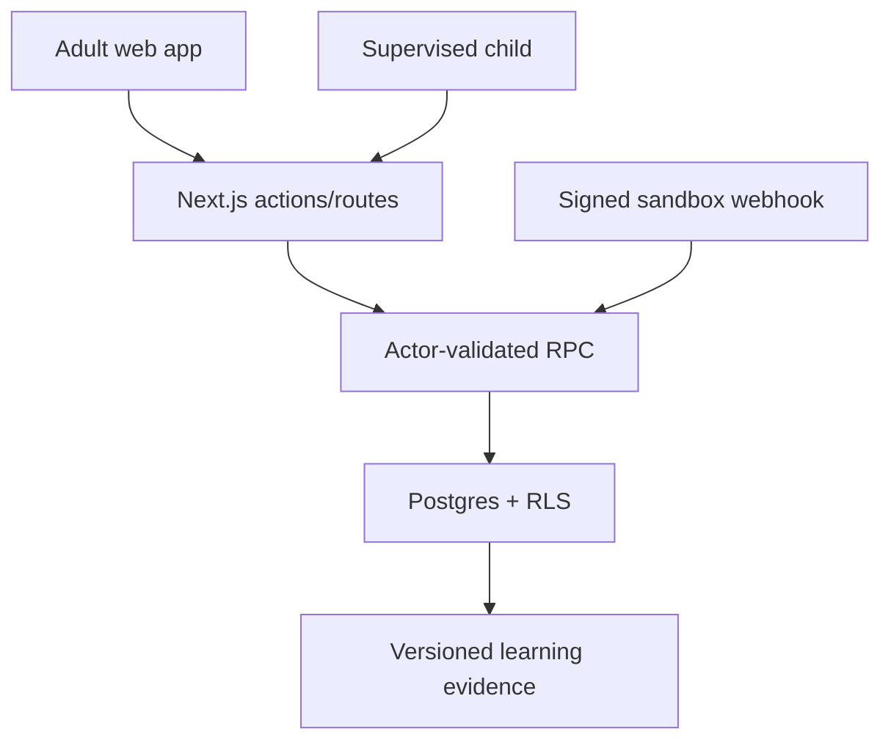
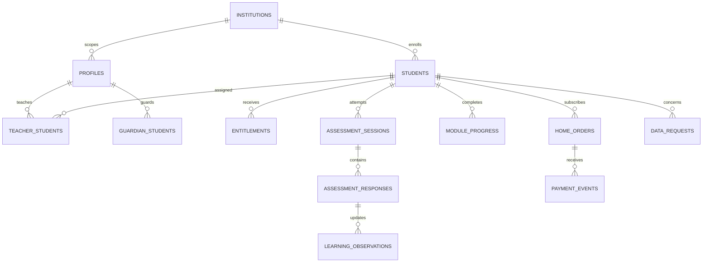

# Technical architecture and inventory

No client owns roles, correctness, error labels, BKT updates, prices or entitlement activation.

## Core ERD

## Migration inventory

| Migration | Responsibility |
|---|---|
| 202611220001_foundation | tenant/profile/student, guardian, consent, entitlement, child session, audit, RLS |
| 202611220002_content | immutable versioned modules and private scoring |
| 202611230003_assessments | assignment, pinned items, sessions, immutable responses, server scoring |
| 202611230004_learning_engine | taxonomy, BKT, evidence, remediation, teacher reviews |
| 202611240005_role_flows | school seats/people and four-role module/progress flow |
| 202611240006_billing | plans, contracts, Home orders, payment events, reconciliation |
| 202611240007_pilot_hardening | export/delete/restrict request ledger |

## RPC contracts

| Domain | RPCs | Caller |
|---|---|---|
| Guardian | list_my_children, claim_guardian_invite, record_consent, request_child_data_action, list_my_data_requests | verified Parent |
| Child session | start_child_session, read_child_session, end_child_session | initiating adult |
| School | school_summary, school_people, school_set_seat, school_assign_teacher, request_seat_change, school_billing_summary | tenant School |
| Assessment | assign_assessment, list/read_assessment, assessment_hint, submit_assessment_response, assessment_report | scoped Teacher/child |
| Learning | learning_insights, submit_teacher_review, assign_activity, list_child_learning, complete_module, child_progress, teacher_overview | scoped caller |
| Home billing | create_home_checkout, home_billing_summary, cancel_home_subscription | verified Parent |
| Internal | operator_review_seat_request | active Operator |
| Service | apply_sandbox_payment_event, expire_home_access | local service role |

Helpers such as `can_read_child`, `valid_consent`, `access_source`, assessment guards, BKT and triggers are not general client APIs.

## Integrity rules

Content/model structures are versioned; responses retain item version. Response, assignment, completion, seat and payment keys reject changed replay payloads. School entitlement wins over Home. Raw responses/model snapshots are immutable; teacher reviews append annotations.